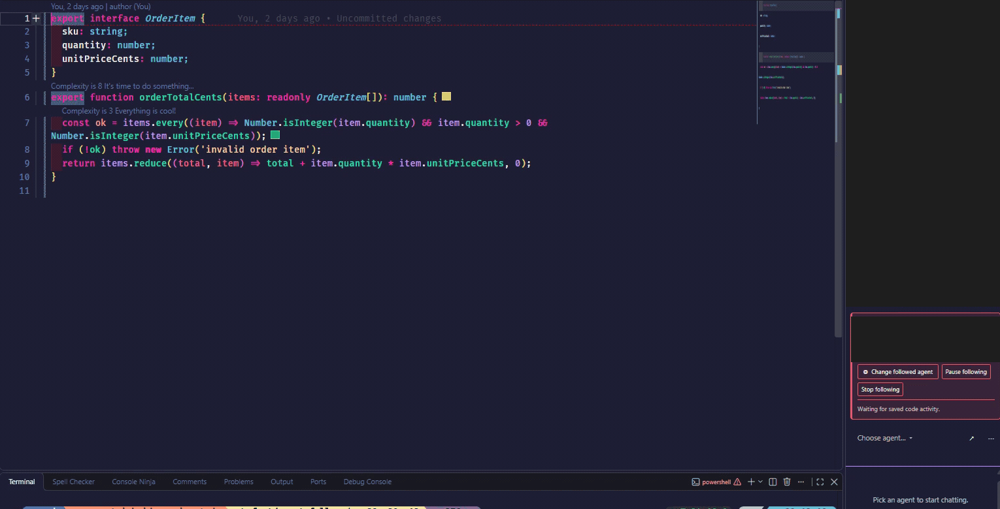
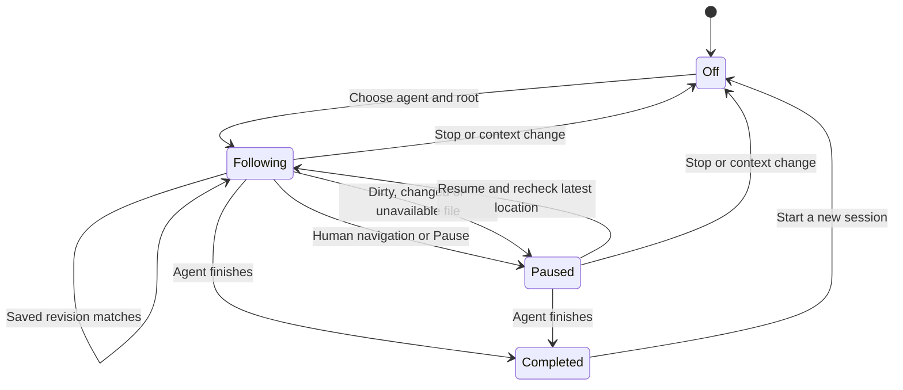
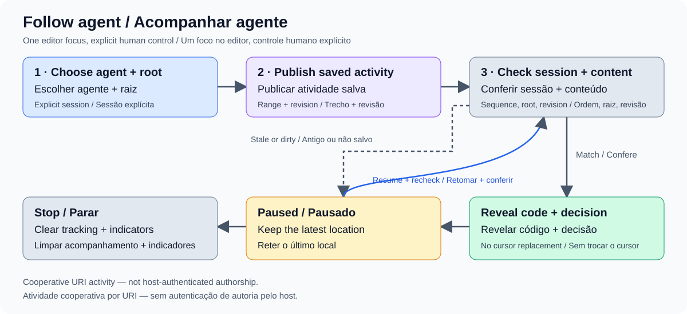

# 🎯 Follow an agent / Acompanhar um agente

[English](#-english) · [Português do Brasil](#-português-do-brasil) · [Roadmap](agent-follow-roadmap.md)

## 🇺🇸 English

Follow a selected agent's cooperative code activity inside VS Code. The editor reveals the saved file and briefly highlights the reported range. Routine changes do not open inline comments; optional decision explanations stay in the Chat card.

### Start and stay in control

1. Open a trusted local project and connect Maestri Bridge to Maestri through its existing pairing flow. In an empty editor window, **Follow agent** offers **Open project**.
2. Choose **Follow agent** in the Chat card, use the **target icon** beside an agent or in the **Agents/Chat** header, or run **Maestri: Follow agent**. Chat and Follow have independent agent choices.
3. Choose an agent and, for a multi-root window, the local project root. The extension sends that agent the session-specific helper instructions.
4. After a meaningful saved change, the agent publishes a `focus` with the provided helper, pointing at the changed lines. Explanations remain in the conversation. An optional `decision` adds an important explanation to the Chat card, without an inline comment. The extension checks the saved revision before revealing the range or displaying the explanation.
5. Use **Pause**, **Resume** or **Stop** in the colored Chat card, view header or Command Palette. Clicking the follow status also toggles pause/resume.

The Chat card shows the followed agent, Maestri workspace, local root, current file and latest verified note. **Change followed agent** opens the chooser again. Canceling keeps the current session. The latest note stays in the card with its original file and line numbers. The editor centers a verified range that is off-screen and keeps the preview group fixed. To open the preview beside your editor, set `maestriBridge.follow.previewPosition` to `beside` before starting the session.

Navigating, editing or leaving the window pauses following and cancels the highlight. While paused, the session retains the latest location and its explanation if available. **Resume** rechecks the saved revision before showing them. **Stop** clears the highlight and Chat card. Following is off after an extension restart.

The highlight clears after about 1.2 seconds. With `workbench.reduceMotion` explicitly set to `off`, it first sweeps through the reported range in at most eight steps within 160 ms. With `on` or `auto`, the complete range appears at once: the extension host cannot resolve the operating system's motion preference, so `auto` conservatively uses static emphasis. Scrolling uses the editor's native behavior; Follow does not change zoom, focus, selection or document text to animate. The reported range is not a computed diff of newly inserted characters.

### 🎥 Current recording: code first, without inline comments



[Play the 33-second MP4](images/agent-follow-live-20261122.mp4).

This is a continuous, normal-speed 33-second excerpt of an 80-second desktop recording of the real Extension Development Host. A reproducible script creates and changes two synthetic files and publishes five cooperative events. A decision stays in the Chat card; no inline comment is created. The fixture's three tests passed separately. Pause, Resume and Stop were also confirmed in the real editor, outside this excerpt.

Both MP4 and GIF preserve the complete 1920 × 1032 editor window, with no spatial crop, resizing or panel masks. The title, tabs, Agents panel, code, Follow card, terminal and status bar remain visible so file navigation can be understood in context. The recording used temporary workspace settings `workbench.reduceMotion: off` and `editor.smoothScrolling: true`; they were removed afterwards. The source is variable-rate, approximately 28.08 fps (30 requested); the MP4 is resampled to 30 fps and the GIF to 20 fps without speeding up time.

The visual review covered five full-size frames, a one-frame-per-second contact sheet and a 10-fps consecutive-frame strip of the highlight. The strip shows a progressing highlight with code continuously visible. This is sampled visual evidence, not a latency benchmark or a claim about every frame's perceived smoothness. The demo does not show automatic interception of arbitrary agent tools.

### 🖼️ Historical VS Code evidence

<details>
<summary>Earlier builds with inline decision notes</summary>

The images below record the original Development Host validation. They predate the inline-comment removal and transient highlight; they are historical evidence, not validation of the current animation.


**Media note:** the GIF is a sequence of four real screenshots from the Extension Development Host: active with a note, paused, resumed and stopped. It is not continuous screen recording. The files and notes shown use a synthetic fixture; no HTML mockup is presented as extension evidence.

#### Live Follow recording


This 38.5-second clip comes from one continuous Development Host recording. Idle intervals were cut and local details were masked. It shows the picker, two saved files, edits to both and the agent's explanations inline and in the Chat card. The three fixture tests passed separately.

</details>

### 🔄 Interaction flow



### Commands / Comandos

Portable interaction overview / Visão estática do fluxo:



| Command ID | English | PT-BR |
| --- | --- | --- |
| `maestriBridge.follow.start` | Follow agent | Acompanhar agente |
| `maestriBridge.follow.pause` | Pause following | Pausar acompanhamento |
| `maestriBridge.follow.resume` | Resume following | Retomar acompanhamento |
| `maestriBridge.follow.stop` | Stop following | Parar acompanhamento |

### 🧩 Cooperative transport and boundaries

This version adds `/activity?event=<JSON>` beside the existing `/show` URI route. The user's explicit selection binds a random local session to an agent and a project root. Events carry a declared agent ID, a growing sequence number and a SHA-256 revision of canonical saved text. `/show` remains the manual walkthrough interface.

The paired Wire connection delivers instructions and replies. The activity URI itself **does not authenticate authorship**: a local process with the session context can construct an event. This is a cooperative pilot, not a new host-authenticated activity API or automatic interception of every editing tool.

The producer and consumer reject invalid paths and Windows alternate streams, bound payloads and ranges, and check file containment/revision. Sensitive file patterns, dirty buffers, stale content and unavailable targets are not automatically revealed. No code edit is repeated when activity publication fails. Pairing, TLS pins and human approvals retain their existing boundaries.

The colored card uses the existing Chat webview and theme colors. Public `StatusBarItem.backgroundColor` supports only error/warning theme backgrounds; the normal follow status therefore uses the agent accent on its text/icon. It does not modify global theme settings.

### ✅ Validation

These results refer to the current implementation. The three synthetic fixture tests are counted separately.

| Check | Result |
| --- | ---: |
| Core Vitest suite | 266 passed |
| VS Code integration-layer Vitest suite | 271 passed |
| Node emitter suite | 16 passed |
| **Total executed tests** | **553 passed** |
| Synthetic recording fixture | 3 passed, separate from the total |
| Typechecks | Core, extension and webview passed |
| Build | Extension, emitter bundle and chat bundle passed |
| Real Extension Development Host | Source/test navigation, Chat-only decision, no visible inline comment, Pause/Resume/Stop confirmed |

These counts are executed tests, not code-coverage percentages or latency measurements. Automated editor tests use mocked VS Code APIs; the manual Development Host check supplies the separate real-editor evidence.

The [original test-report image](images/agent-follow-tests.svg) is historical; the table above contains the current counts.

Reproduce from the repository root after installing the existing lockfile dependencies:

```sh
pnpm typecheck
pnpm test
node --test --test-concurrency=1 skills/maestri-bridge/scripts/emit-activity.test.mjs
pnpm build
```

Use **Run Maestri extension** in the debugger, select a demo agent and let it publish a saved text-file range using the supplied session context. Test human navigation, an unsaved/stale target, Pause/Resume and Stop. Do not publish tokens, pairing codes, real secrets or private source in screenshots.

The development launcher passes the project folder explicitly. For a CLI launch, use `code --folder-uri file:///absolute/project/path --extensionDevelopmentPath=/absolute/project/path/integrations/vscode`, adapting the URI and native paths to your system. Confirm the folder in the Development Host itself before starting Follow.

## 🇧🇷 Português do Brasil

Acompanhe a atividade cooperativa de código de um agente no VS Code. O editor revela o arquivo salvo e destaca brevemente o intervalo informado. Alterações rotineiras não abrem comentários junto ao código; explicações opcionais de decisão ficam no cartão do Chat.

### Como usar

1. Abra um projeto local confiável e conecte a Bridge pelo pareamento existente. Em uma janela vazia, **Acompanhar agente** oferece a ação **Abrir projeto**.
2. Use **Acompanhar agente** no cartão do Chat, o **ícone de alvo** da linha do agente ou do cabeçalho de **Agentes/Chat**, ou **Maestri: Acompanhar agente** na paleta. Chat e acompanhamento têm seleções independentes.
3. Escolha o agente e, em uma janela com várias pastas, a raiz local. A extensão envia ao agente as instruções do helper para aquela sessão.
4. Após salvar uma alteração significativa, o agente usa `focus` para apontar as linhas alteradas. Explicações ficam na conversa. Um `decision` opcional acrescenta uma explicação importante ao cartão do Chat, sem abrir comentário no editor. A extensão confere a revisão salva antes de revelar o trecho ou apresentar a explicação.
5. Use **Pausar**, **Retomar** e **Parar** no cartão colorido, no cabeçalho ou na paleta. O indicador da barra também alterna pausa/retomada.

O cartão mostra agente, workspace Maestri, raiz local, arquivo em foco e a última nota validada. **Trocar agente acompanhado** abre o seletor novamente. Cancelar preserva a sessão atual. A última nota permanece no cartão com o arquivo e as linhas originais. O editor centraliza o trecho validado que está fora da área visível e mantém o grupo de prévia fixo. Para abrir a prévia ao lado, defina `maestriBridge.follow.previewPosition` como `beside` antes de iniciar a sessão.

Navegar, editar ou sair da janela pausa o acompanhamento e cancela o destaque. Durante a pausa, a sessão guarda a última localização e a explicação correspondente, se houver. **Retomar** confere a revisão salva antes de exibir o trecho e a explicação. **Parar** limpa o destaque e o cartão do Chat. O acompanhamento começa desligado após reiniciar a extensão.

O destaque desaparece após cerca de 1,2 segundo. Com `workbench.reduceMotion` definido explicitamente como `off`, ele percorre primeiro o intervalo em até oito etapas dentro de 160 ms. Com `on` ou `auto`, o trecho inteiro aparece de uma vez: o extension host não resolve a preferência de movimento do sistema, então `auto` usa destaque estático por cautela. A rolagem segue o comportamento nativo do editor; o Follow não altera zoom, foco, seleção ou texto para animar. O intervalo informado não é um diff calculado dos caracteres inseridos.

### Gravação atual


[Reproduzir o MP4 de 33 segundos](images/agent-follow-live-20261122.mp4).

É um trecho contínuo de 33 segundos, em velocidade normal, de uma gravação de desktop de 80 segundos do Development Host real. Um script reproduzível cria e altera dois arquivos sintéticos e publica cinco eventos cooperativos. A decisão fica no cartão do Chat, sem comentário junto ao código. Os três testes da fixture passaram à parte. Pausar, Retomar e Parar também foram conferidos no editor real, fora deste recorte.

MP4 e GIF preservam a janela inteira de 1920 × 1032, sem crop espacial, redimensionamento ou máscaras nos painéis. Título, abas, painel Agents, código, cartão Follow, terminal e barra de status permanecem visíveis para contextualizar a navegação. A gravação usou temporariamente `workbench.reduceMotion: off` e `editor.smoothScrolling: true` apenas no workspace, removidos após o teste. A origem tem taxa variável de aproximadamente 28,08 fps (30 solicitados); MP4 e GIF foram reamostrados para 30 e 20 fps sem acelerar o tempo.

A revisão visual examinou cinco quadros completos, um contato a 1 fps e uma sequência consecutiva do destaque a 10 fps. A sequência mostra o destaque progredindo com o código sempre visível. É evidência visual amostrada, sem benchmark de latência nem afirmação de fluidez subjetiva em todos os quadros. A demo não demonstra interceptação automática de ferramentas arbitrárias.

As mídias antigas com comentários são históricas; estão recolhidas na seção em inglês e não validam o comportamento atual. A versão atual tem 553 testes (266 núcleo, 271 extensão, 16 emissor), além dos três testes da fixture. Typecheck e build passaram.

### Limites importantes

Esta versão acompanha **um agente conduzindo o editor por vez**. O canal `/activity` é cooperativo: a identidade é declarada pelo emissor, não autenticada por uma API nova do host. O agente precisa publicar atividade após salvar; a extensão não intercepta universalmente todas as ferramentas de edição.

A conexão Wire pareada entrega instruções e respostas. Sessão, sequência e hash ajudam no roteamento e na consistência, mas não substituem autenticação de autoria. Arquivos sensíveis, fora da raiz física, não salvos, alterados ou indisponíveis não são revelados automaticamente. Pareamento, pins TLS e aprovações continuam humanos.

O fundo colorido fica no cartão do Chat. A API nativa da barra de status limita fundos a aviso/erro; por isso o indicador normal usa o acento no texto/ícone, sem mudar o tema global.

### Evidência e testes

As imagens registram a validação original no Development Host. O GIF reúne quatro screenshots reais com os estados ativo com nota, pausado, retomado e parado.

O [novo recorte de 38,5 segundos](images/agent-follow-live.gif) veio de uma gravação contínua do Development Host. O recorte remove esperas e oculta detalhes locais. Ele mostra o seletor, a criação e a edição de dois arquivos sintéticos e as explicações do agente no trecho e no cartão. Os três testes da demonstração passaram em uma execução separada.

Foram executados **553 testes**: 266 do núcleo, 271 da camada VS Code e 16 do emissor; os três testes da fixture foram executados separadamente. Typechecks e builds passaram. Os testes automatizados do editor usam mocks; a validação no editor real comprovou navegação, decisão no cartão e os estados de Pausar, Retomar e Parar. A sequência de quadros amostrados registra o destaque. Os números não representam cobertura percentual ou desempenho medido.

As futuras capacidades, dependências e critérios propostos estão no [roadmap bilíngue](agent-follow-roadmap.md).

## References / Referências

- [VS Code API: editor, URI handler, status bar and decorations](https://code.visualstudio.com/api/references/vscode-api)
- [VS Code webview accessibility](https://code.visualstudio.com/api/extension-guides/webview#accessibility)
- [Contribution guidelines](../CONTRIBUTING.md)
