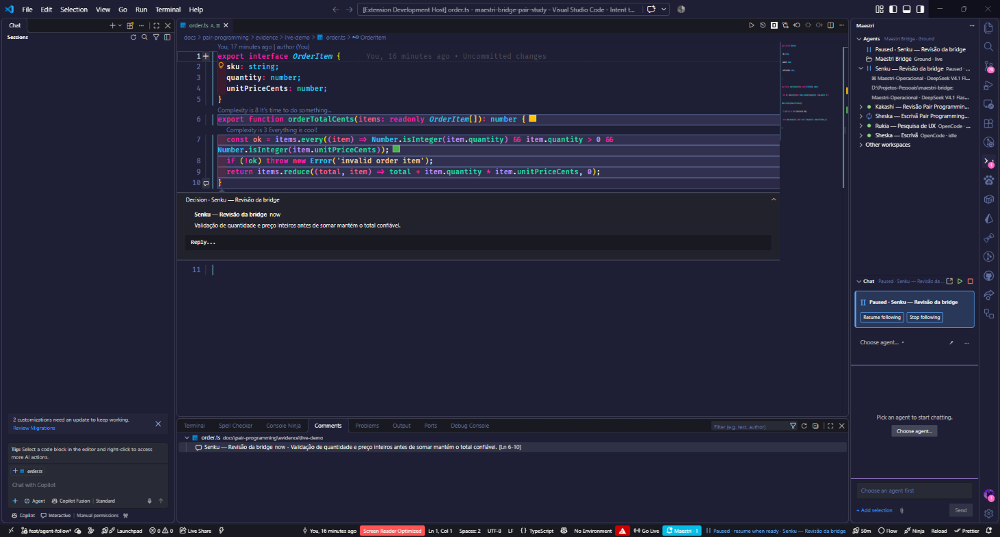
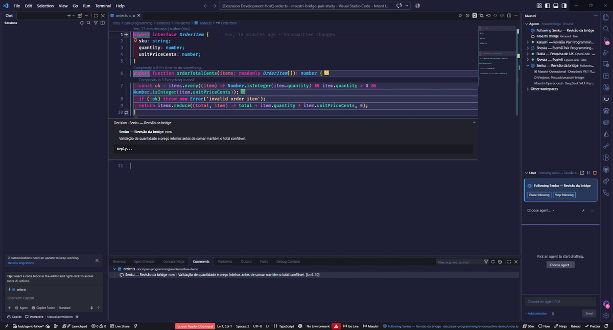
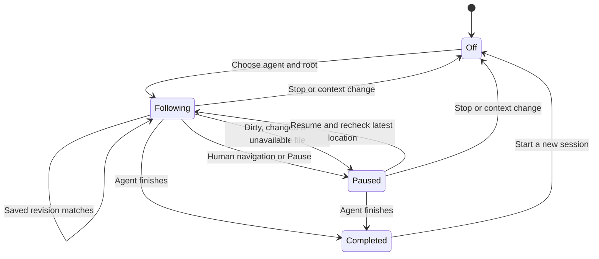

# 🎯 Follow an agent / Acompanhar um agente

[English](#-english) · [Português do Brasil](#-português-do-brasil) · [Roadmap](agent-follow-roadmap.md)

## 🇺🇸 English

Follow a selected agent's cooperative code activity inside VS Code. The editor reveals the saved file, highlights the current range and shows a short, replyable decision note when the agent supplies one.

### Start and stay in control

1. Open a trusted local project and connect Maestri Bridge to Maestri through its existing pairing flow.
2. Click the **target icon** beside an agent or in the **Agents/Chat** header, or run **Maestri: Follow agent**.
3. Choose an agent and, for a multi-root window, the local project root. The extension sends that agent the session-specific helper instructions.
4. After saving code, the agent publishes activity with the provided helper. The extension checks the content revision before revealing the range or displaying a note.
5. Use **Pause**, **Resume** or **Stop** in the colored Chat card, view header or Command Palette. Clicking the follow status also toggles pause/resume.

The agent's name remains visible in the persistent Agents summary, its tree row, the Chat header/card and the status bar. A stable agent color ties these indicators to the file decoration in the tab/Explorer, subject to the editor's decoration settings. The existing Git badge remains available.

Navigating, editing or leaving the window pauses following. While paused, only the latest code location is retained. Resume rechecks it and does not replay old decision notes. Stop removes the follow indicators, highlight and note. Following is off after an extension restart.

### 🖼️ Real VS Code evidence






**Media note:** the GIF is a sequence of four real screenshots from the Extension Development Host: active with a note, paused, resumed and stopped. It is not continuous screen recording. The files and notes shown use a synthetic fixture; no HTML mockup is presented as extension evidence.

### 🔄 Interaction flow



### Commands / Comandos

| Command ID | English | PT-BR |
| --- | --- | --- |
| `maestriBridge.follow.start` | Follow agent | Acompanhar agente |
| `maestriBridge.follow.pause` | Pause following | Pausar acompanhamento |
| `maestriBridge.follow.resume` | Resume following | Retomar acompanhamento |
| `maestriBridge.follow.stop` | Stop following | Parar acompanhamento |
| `maestriBridge.follow.reply` | Reply to agent | Responder ao agente |

### 🧩 Cooperative transport and boundaries

This version adds `/activity?event=<JSON>` beside the existing `/show` URI route. The user's explicit selection binds a random local session to an agent and a project root. Events carry a declared agent ID, a growing sequence number and a SHA-256 revision of canonical saved text. `/show` remains the manual walkthrough interface.

The paired Wire connection delivers instructions and replies. The activity URI itself **does not authenticate authorship**: a local process with the session context can construct an event. This is a cooperative pilot, not a new host-authenticated activity API or automatic interception of every editing tool.

The producer and consumer reject invalid paths and Windows alternate streams, bound payloads and ranges, and check file containment/revision. Sensitive file patterns, dirty buffers, stale content and unavailable targets are not automatically revealed. No code edit is repeated when activity publication fails. Pairing, TLS pins and human approvals retain their existing boundaries.

The colored card uses the existing Chat webview and theme colors. Public `StatusBarItem.backgroundColor` supports only error/warning theme backgrounds; the normal follow status therefore uses the agent accent on its text/icon. It does not modify global theme settings.

### ✅ Validation

| Check | Result |
| --- | ---: |
| Core Vitest suite | 266 passed |
| VS Code integration-layer Vitest suite | 254 passed |
| Node emitter suite | 16 passed |
| **Total executed tests** | **536 passed** |
| Typechecks | Core, extension and webview passed |
| Build | Extension, emitter bundle and chat bundle passed |
| Manual Extension Development Host | Follow, inline note, card Pause/Resume/Stop, persistent indicators and file decoration verified |

These counts are executed tests, not code-coverage percentages or latency measurements. Automated editor tests use mocked VS Code APIs; the manual Development Host check supplies the separate real-editor evidence.

Reproduce from the repository root after installing the existing lockfile dependencies:

```sh
pnpm typecheck
pnpm test
node --test --test-concurrency=1 skills/maestri-bridge/scripts/emit-activity.test.mjs
pnpm build
```

Use **Run Maestri extension** in the debugger, select a demo agent and let it publish a saved text-file range using the supplied session context. Test human navigation, an unsaved/stale target, Pause/Resume and Stop. Do not publish tokens, pairing codes, real secrets or private source in screenshots.

## 🇧🇷 Português do Brasil

Acompanhe a atividade cooperativa de código de um agente no VS Code. O editor revela o arquivo salvo, destaca o intervalo atual e mostra uma nota de decisão respondível quando o agente fornece uma explicação.

### Como usar

1. Abra um projeto local confiável e conecte a Bridge pelo pareamento existente.
2. Clique no **ícone de alvo** da linha do agente ou do cabeçalho de **Agentes/Chat**. Também há **Maestri: Acompanhar agente** na paleta.
3. Escolha o agente e, em uma janela com várias pastas, a raiz local. A extensão envia ao agente as instruções do helper para aquela sessão.
4. Após gravar o código, o agente publica a atividade. A revisão do conteúdo é conferida antes de revelar o trecho ou apresentar a nota.
5. Use **Pausar**, **Retomar** e **Parar** no cartão colorido, no cabeçalho ou na paleta. O indicador da barra também alterna pausa/retomada.

O nome do agente aparece no resumo persistente de Agentes, na linha dele, no cabeçalho/cartão do Chat e na barra de status. A mesma cor estável conecta esses pontos à marca do arquivo na aba/Explorer, conforme as configurações de decorations. A indicação Git continua disponível.

Navegar, editar ou sair da janela pausa o acompanhamento. A pausa retém apenas a última localização; retomar confere o conteúdo novamente e não reproduz notas antigas. Parar remove indicadores, destaque e nota. Reiniciar a extensão não reativa o acompanhamento automaticamente.

### Limites importantes

Esta versão acompanha **um agente conduzindo o editor por vez**. O canal `/activity` é cooperativo: a identidade é declarada pelo emissor, não autenticada por uma API nova do host. O agente precisa publicar atividade após salvar; a extensão não intercepta universalmente todas as ferramentas de edição.

A conexão Wire pareada entrega instruções e respostas. Sessão, sequência e hash ajudam no roteamento e na consistência, mas não substituem autenticação de autoria. Arquivos sensíveis, fora da raiz física, não salvos, alterados ou indisponíveis não são revelados automaticamente. Pareamento, pins TLS e aprovações continuam humanos.

O fundo colorido fica no cartão do Chat. A API nativa da barra de status limita fundos a aviso/erro; por isso o indicador normal usa o acento no texto/ícone, sem mudar o tema global.

### Evidência e testes

As imagens acima vêm da extensão real no Development Host. O GIF reúne quatro screenshots reais — ativo com nota, pausado, retomado e parado — e não representa uma gravação contínua nem um protótipo HTML.

Foram executados **536 testes**: 266 do core, 254 da camada VS Code e 16 do emissor. Typechecks e builds passaram. Os testes automatizados do editor usam mocks; a validação manual comprovou o fluxo no VS Code, incluindo os botões do próprio cartão. Os números não representam cobertura percentual ou desempenho medido.

As futuras capacidades, dependências e critérios propostos estão no [roadmap bilíngue](agent-follow-roadmap.md).

## References / Referências

- [VS Code API: editor, URI handler, status bar and decorations](https://code.visualstudio.com/api/references/vscode-api)
- [VS Code webview accessibility](https://code.visualstudio.com/api/extension-guides/webview#accessibility)
- [Contribution guidelines](../CONTRIBUTING.md)
