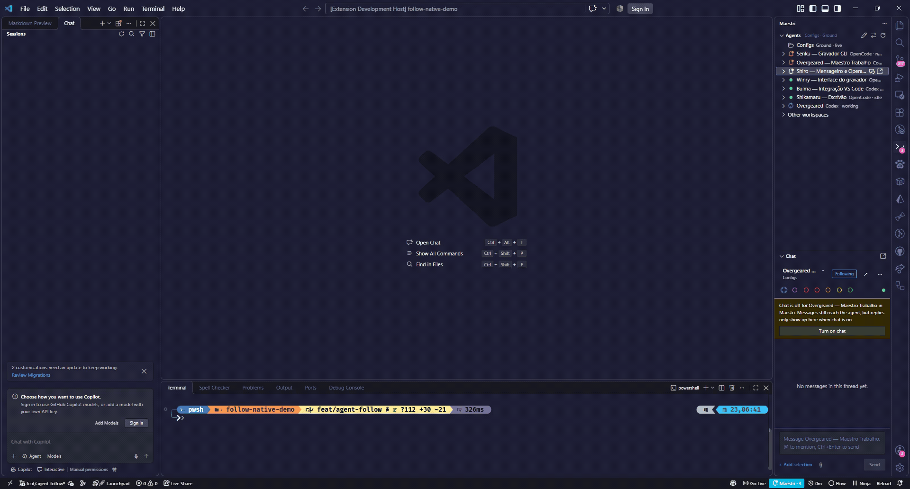

# Follow saved changes in VS Code

Open the Maestri Chat for an agent and turn on **Follow** in its header. The extension watches one trusted local folder open in VS Code. It uses the matching ground-floor workspace directory when the mapping is unambiguous. If the target's folder cannot be resolved, select the matching local folder when prompted.

Follow compares the saved contents at session start with the latest saved text. It opens a read-only native diff and reveals the latest change without changing your selection. New and deleted files use an empty side. Follow reports folder activity because anyone with access to the folder can change it.

A mouse or keyboard selection change in the editor pauses automatic navigation. **N files changed · View** appears on its own line below the Chat header, leaving room for the agent selector. **View** opens the latest pending change directly and resumes navigation; there is no second file picker. Saves arriving while a diff opens remain pending. Switching applications or resizing the editor leaves Follow running. The editor API may omit clicks that leave the selection unchanged.

Turn off Follow to stop. Changing the chat target also stops the session. Snapshots stay in memory. The extension excludes sensitive, non-text and out-of-scope files. Unsaved editor text stays outside the diff.

## Folder limits and exclusions

Follow uses VS Code's `files.exclude` rules and the built-in Git extension's ignore check before spending its baseline budget. Git rules require the Git extension and a repository it can open. If that service is unavailable or a known repository's query fails, Follow warns and skips the unverified batch; it does not interpret failure as permission to read ignored files. A later save retries the query. A folder with no repository has no Git ignore coverage. Changing `files.exclude` or saving a `.gitignore` invalidates in-flight eligibility results and refreshes cached eligibility. Files newly admitted to coverage establish a reference on their next save; past excluded activity is not reconstructed.

The initial text snapshot is limited to 2,000 files and 16 MiB. The previous-save cache has a separate 2,000-file/16 MiB budget: at most 32 MiB of cached text, plus bounded metadata and temporary read buffers. Crossing a snapshot limit leaves Follow running with partial coverage. A retained initial baseline survives eviction of recent text. For a preexisting file with neither initial nor recent text available, the first save establishes a reference without opening a misleading empty-to-content diff; the next save compares against that reference. Discovery and queued metadata also have bounds; exceeding coverage produces a warning instead of stopping the session.

Symlinked project roots are resolved to their physical directories. Individual files must still remain inside that physical root and pass the regular-file checks. A missing root, a changed root and a failed initial snapshot have distinct messages. Saved changes are grouped briefly before navigation; within a batch, saved-file timestamps determine the latest file, with event order breaking ties. This avoids using lexical filename order as save order; identical timestamps cannot establish an exact chronology across files.

Use **/show** when you want the agent to explain code with highlighted lines and notes.

## Real Windows editor demo

[Play the MP4](images/follow-corrections-20261123.mp4) · [Reproduce the save scenario](pair-programming/evidence/follow-native-demo/README.md) · [Native exclusion verification](pair-programming/evidence/follow-native-corrections-20261123/README.md)

The approximately 60-second clip joins seven excerpts from a real 265.767-second Windows desktop capture. Only waiting periods were removed; each excerpt plays at its original speed. The complete 1920 × 1032 VS Code window is preserved, without spatial crop, scaling, masks or overlays. The source averaged about 27.99 fps. The GIF has 1,200 frames at 20 fps (60 seconds); the MP4 has 1,799 frames at 30 fps (59.967 seconds).

The clip shows:

- A PowerShell save opening the native diff against the original session baseline.
- A real selection pausing navigation, followed by **2 files changed · View** on its own row below the Chat header.
- **View** opening the latest saved test file directly, with no second picker, then resuming.
- A later saved test appearing automatically: the diff retains the one-test baseline and shows the three-test version.
- Thirty new files ending at **burst/b29.mjs**. Intermediate previews for b0 and b24 remain visible; the recording does not claim one preview for the whole burst.
- The header returning to the inactive **Follow** button. **Stop is inside this clip.**

No message or prompt was sent to the Chat target. Follow observed filesystem saves directly, without an activity helper or URI. Agent names and ordinary editor notices remain authentic UI. Review used eight final full-size frames, a contact sheet and the first GIF frame; no concrete personal data was identified in those samples. This is sampled real-editor evidence, not a latency benchmark or a claim about every frame's perceived smoothness.

The invoice fixture passed 1/1, 2/2 and 3/3 tests at successive stages and was restored byte-for-byte after Follow was stopped. The generated burst files were removed after checking that the directory contained only those 30 synthetic files.

## Native filesystem verification

The separate development-only harness uses the product watcher and real VS Code/Git APIs. On Windows with VS Code 1.147.0, it confirmed trusted operation, Git availability, a recognized repository and successful ignore queries. A folder with 2,100 ignored text files reached ready without a snapshot warning. Saves in that folder and in a native files.exclude directory emitted no changes; an eligible save emitted exactly once with its initial baseline preserved. A junction root reached ready too.

The helper is not installed, does not pair the Bridge, and does not change trust. The successful proof ran in a normal Extension Development Host. Failed ExtensionTests attempts with a different trust/API state are not used as passing evidence.

Automated checks passed on Windows: **234 core + 297 VS Code tests = 531 passed, one skipped**, plus typecheck and build. The skipped case creates a file symlink on Windows. Tests cover text and metadata budgets, canonical roots, root replacement during reads, exclusion changes in flight, Git query failure, LRU baseline retention, creation/deletion, burst ordering and delayed/failed preview opens.

macOS execution, isolated focus between two applications, and clicks that preserve the selection remain manual-validation limits. An earlier Windows check kept Follow active through panel changes and minimization; it did not isolate cross-application foreground behavior.

### Português do Brasil

O clipe atual mostra o editor real com a janela inteira: diff contra a baseline inicial, pausa por seleção, **2 arquivos alterados · Ver** em linha própria, **Ver** direto no último arquivo sem seletor, retomada, rajada terminando em b29 e desligamento dentro do vídeo. São sete trechos em velocidade normal, removendo só esperas, sem cortar laterais ou esconder painéis.

A prova nativa confirmou Git e files.exclude reais, 2.100 arquivos ignorados sem consumir a baseline e raiz junction. Os 531 testes passaram, com um skip no Windows, além de typecheck e build. A revisão da mídia é amostrada, sem benchmark. A rajada inclui previews intermediários; não se promete um único diff. macOS, foco isolado entre aplicativos e cliques sem mudança de seleção mantêm os limites declarados.

## Historical demonstrations

The [previous Windows recording](images/follow-native-demo-20261122.mp4) shows the former View picker and is historical. The [cooperative pilot](https://github.com/JeffyMesquita/maestri-bridge/blob/e57ad259e99e331309f8e07755a9c576eda58e22/docs/agent-follow.md) is historical too.

## Local verification

In an Extension Development Host, open a trusted folder with one small text file. Start Follow and save two changes to that file from a separate terminal. Check that the left side remains the original saved content and the right side reveals the latest edit without taking focus.

Change the editor selection, then save changes to two files. Check that the two-file indicator occupies its own line and use **View** to open the latest diff directly, without a file picker. Check that changes made while the diff opens and saves after resuming still appear. Repeat with a dirty buffer, a deleted file, a file outside the selected folder and a layout change. Also check a Git-ignored folder, `files.exclude`, a symlinked project root, and a burst of saves whose names sort differently from their save order.
