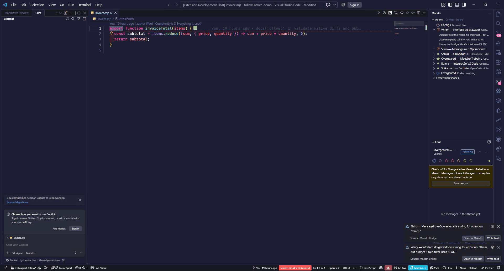

# Follow saved changes in VS Code

Open the Maestri Chat for an agent and turn on **Follow** in its header. The extension watches one trusted local folder open in VS Code. It uses the matching ground-floor workspace directory when the mapping is unambiguous. If the target's folder cannot be resolved, select the matching local folder when prompted.

Follow compares the saved contents at session start with the latest saved text. It opens a read-only native diff and reveals the latest change without changing your selection. New and deleted files use an empty side. Follow reports folder activity because anyone with access to the folder can change it.

A mouse or keyboard selection change in the editor pauses automatic navigation. **N files changed · View** appears on its own line below the Chat header, leaving room for the agent selector. **View** opens the latest pending change directly and resumes navigation; there is no second file picker. Saves arriving while a diff opens remain pending. Switching applications or resizing the editor leaves Follow running. The editor API may omit clicks that leave the selection unchanged.

Turn off Follow to stop. Changing the chat target also stops the session. Snapshots stay in memory. The extension excludes sensitive, non-text and out-of-scope files. Unsaved editor text stays outside the diff.

## Folder limits and exclusions

Follow uses VS Code's `files.exclude` rules and the built-in Git extension's ignore check before spending its baseline budget. Git rules require the Git extension and a repository it can open. If that service is unavailable or a known repository's query fails, Follow warns and skips the unverified batch; it does not interpret failure as permission to read ignored files. A later save retries the query. A folder with no repository has no Git ignore coverage. Changing `files.exclude` or saving a `.gitignore` invalidates in-flight eligibility results and refreshes cached eligibility. Files newly admitted to coverage establish a reference on their next save; past excluded activity is not reconstructed.

The initial text snapshot is limited to 2,000 files and 16 MiB. The previous-save cache has a separate 2,000-file/16 MiB budget: at most 32 MiB of cached text, plus bounded metadata and temporary read buffers. Crossing a snapshot limit leaves Follow running with partial coverage. A retained initial baseline survives eviction of recent text. For a preexisting file with neither initial nor recent text available, the first save establishes a reference without opening a misleading empty-to-content diff; the next save compares against that reference. Discovery and queued metadata also have bounds; exceeding coverage produces a warning instead of stopping the session.

Symlinked project roots are resolved to their physical directories. Individual files must still remain inside that physical root and pass the regular-file checks. A missing root, a changed root and a failed initial snapshot have distinct messages. Saved changes are grouped briefly before navigation; within a batch, saved-file timestamps determine the latest file, with event order breaking ties. This avoids using lexical filename order as save order; identical timestamps cannot establish an exact chronology across files.

Use **/show** when you want the agent to explain code with highlighted lines and notes.

## Real Windows editor demo

[Play the MP4](images/follow-burst-final-20261123.mp4) · [Reproduce the save scenario](pair-programming/evidence/follow-native-demo/README.md) · [Native exclusion verification](pair-programming/evidence/follow-native-corrections-20261123/README.md)

The final clip is 15 seconds (0-15) of the paired Windows host: the burst of thirty saved files ends on **burst/b29.mjs** with a single presentation in that window. **Stop was validated outside this clip**, after the recording; the clip does not show it. The window is the full 1920 × 1032 editor, without crop, scaling, masks or overlays. The GIF is 300 frames at 20 fps (1,043,773 bytes); the MP4 is 450 frames at 30 fps (228,303 bytes). The clip is real-editor evidence; it makes no continuous-playback claim.

Historical media (60 s, superseded)

[Previous MP4](images/follow-corrections-20261123.mp4)

The approximately 60-second clip joined seven excerpts from a real 265.767-second Windows desktop capture. Only waiting periods were removed; each excerpt played at its original speed. The complete 1920 × 1032 VS Code window was preserved, without spatial crop, scaling, masks or overlays. The source averaged about 27.99 fps. The GIF had 1,200 frames at 20 fps (60 seconds); the MP4 had 1,799 frames at 30 fps (59.967 seconds).

That recording showed a PowerShell save opening the native diff against the original session baseline, a real selection pausing navigation followed by **2 files changed · View** on its own row, **View** opening the latest saved file directly and resuming, a later save appearing automatically with the three-test version, and thirty new files ending at **burst/b29.mjs** with intermediate previews for b0 and b24. Its header returned to the inactive **Follow** button. **Stop is inside this clip.**

Review of that recording used eight final full-size frames, a contact sheet and its first GIF frame; no concrete personal data was identified in those samples.

No message or prompt was sent to the Chat target. Follow observed filesystem saves directly, without an activity helper or URI. Agent names and ordinary editor notices remain authentic UI. The current asset was reviewed on four full-size frames, the GIF first frame and the contact sheet; no concrete personal data was identified in those samples. This is sampled real-editor evidence, not a latency benchmark or a claim about every frame's perceived smoothness.

The invoice fixture passed 1/1, 2/2 and 3/3 tests at successive stages and was restored byte-for-byte after Follow was stopped. The generated burst files were removed after checking that the directory contained only those 30 synthetic files.

## Native filesystem verification

The separate development-only harness uses the product watcher and real VS Code/Git APIs. On Windows with VS Code 1.147.0, it confirmed trusted operation, Git availability, a recognized repository and successful ignore queries. A folder with 2,100 ignored text files reached ready without a snapshot warning. Saves in that folder and in a native files.exclude directory emitted no changes; an eligible save emitted exactly once with its initial baseline preserved. A junction root reached ready too.

The helper is not installed, does not pair the Bridge, and does not change trust. The successful proof ran in a normal Extension Development Host. Failed ExtensionTests attempts with a different trust/API state are not used as passing evidence.

Current checks: **235 core + 316 VS Code = 551 passed**, with 3 explicit Windows skips (two darwin-only cases and one pre-existing); `pnpm typecheck` and `pnpm build` pass, and CI run 45236149387 at `754c8aaa` is green on Ubuntu, Windows and macOS (macos-26-intel). Tests cover text and metadata budgets, canonical roots, root replacement during reads, exclusion changes in flight, Git query failure, LRU baseline retention, creation/deletion, burst ordering and delayed/failed preview opens.

Previous check (531)

Earlier head: **234 core + 297 VS Code = 531 passed, one skipped** (the skipped case creates a file symlink on Windows), plus typecheck and build.

macOS CI runs the real filesystem with the VS Code API mocked by vitest and passed on all three OS; the macOS **GUI** was not executed. Isolated focus between two applications and clicks that preserve the selection remain manual-validation limits. An earlier Windows check kept Follow active through panel changes and minimization; it did not isolate cross-application foreground behavior.

### Português do Brasil

O clipe final tem 15 segundos (0-15) do host Windows pareado: a rajada de trinta arquivos termina em **burst/b29.mjs** com uma única apresentação nessa janela. O **Stop foi validado fora deste clipe**, depois da gravação; o vídeo não o mostra. A janela é o editor 1920 × 1032 inteiro, sem corte, escala, máscara ou sobreposição.

A prova nativa confirmou Git e files.exclude reais, 2.100 arquivos ignorados sem consumir a baseline e raiz junction. A CI macOS roda o filesystem real com a API do VS Code mockada e passou nos três OS; a **GUI** do macOS não foi executada. Foco isolado entre aplicativos e cliques sem mudança de seleção mantêm os limites declarados. A revisão da mídia é amostrada, sem benchmark.

## Historical demonstrations

The [previous Windows recording](images/follow-native-demo-20261122.mp4) shows the former View picker and is historical. The [cooperative pilot](https://github.com/JeffyMesquita/maestri-bridge/blob/e57ad259e99e331309f8e07755a9c576eda58e22/docs/agent-follow.md) is historical too.

## Local verification

In an Extension Development Host, open a trusted folder with one small text file. Start Follow and save two changes to that file from a separate terminal. Check that the left side remains the original saved content and the right side reveals the latest edit without taking focus.

Change the editor selection, then save changes to two files. Check that the two-file indicator occupies its own line and use **View** to open the latest diff directly, without a file picker. Check that changes made while the diff opens and saves after resuming still appear. Repeat with a dirty buffer, a deleted file, a file outside the selected folder and a layout change. Also check a Git-ignored folder, `files.exclude`, a symlinked project root, and a burst of saves whose names sort differently from their save order.

Historical checkpoints (process log)

## Validation evidence (checkpoint 2026-11-23T12:50:00Z)

- Native proof (Windows, Extension Development Host): the isolated harness (`native-host/result.json`, `2026-11-23T12:06:17.688Z`-`2026-11-23T12:06:40.209Z`, nonce `mwt7zsp0c1uokx`) asserts `openedCount === 1`, a single presented filename and a single modified virtual document, both `b29.ts`, with pending 0 and phase following. It comes from the WIP of this burst correction, later consolidated in `4116936`; no executed commit SHA was verified, and the artifact is distinct from the CI wiring at `1ff2637`.
- CI: fork `JeffyMesquita/maestri-bridge`, branch `feat/follow-burst-validation-20261123`, run `45177589816` at `1ff26378e3b4f5c6bcb7987c0118e9658d91614d` - Ubuntu, Windows and macOS all success. The macOS runner was `macos26 arm64`: 235 core + 313 VS Code tests, no skip, and the `/var/tmp` vs `/private/var/tmp` regressions ran there.
- Windows local: 235 core passed; 310 VS Code passed with 3 explicit skips (2 darwin-only cases plus 1 pre-existing).
- Limits: the macOS job runs the real filesystem through the VS Code API mocked by vitest; it is not a GUI run. Native GUI validation exists only for Windows. No "Mac GUI tested" claim is made.
- Media: the previous GIF keeps its intermediate burst previews and belongs to the earlier history. At this checkpoint the replacement media was still pending and unpublished.

Paired burst verification (2026-11-23T17:39:28Z-17:39:29Z): on the paired Extension Development Host with bundle `eadf57cb...d37065f`, the 30-file burst (the script sleeps 2 ms between writes; that is the requested value, not a measured cadence) produced a single presentation, `burst/b29.mjs`, result true; 30 changes, no intermediate preview. Temporary tracing was removed after the measurement.

Clean bundle and second capture: shipped bundle is 391,096 bytes (sha256 `3a7983b3...dc52b1ab`, no tracing). The second capture used a clean 40 s raw (601,211 bytes, 1,123 frames) and the CLI burst at 2026-11-23T18:11:28Z-18:11:29Z. CI passed on all three OS for SHA `754c8aaa` (run 45236149387, macos-26-intel); earlier runs are historical. At that checkpoint the 15 s clip was still pending acceptance.

