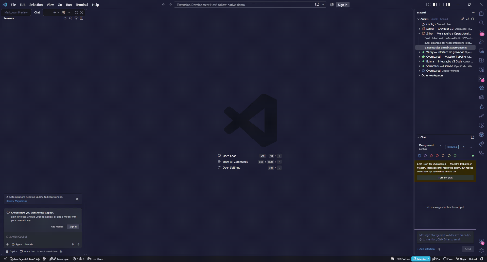

# Follow saved changes in VS Code

Open the Maestri Chat for an agent and turn on **Follow** in its header. The extension watches one trusted local folder open in VS Code. It uses the matching ground-floor workspace directory when the mapping is unambiguous. If the target's folder cannot be resolved, select the matching local folder when prompted.

Follow compares the saved contents at session start with the latest saved text. It opens a read-only native diff and reveals the latest change without changing your selection. New and deleted files use an empty side. Follow reports folder activity because anyone with access to the folder can change it.

A mouse or keyboard selection change in the editor pauses automatic navigation. **N files changed · View** opens a pending change and resumes navigation. Use the file picker when several changes are pending. Switching applications or resizing the editor leaves Follow running. The editor API may omit clicks that leave the selection unchanged.

Turn off Follow to stop. Changing the chat target also stops the session. Snapshots stay in memory. The extension excludes sensitive, non-text and out-of-scope files. Unsaved editor text stays outside the diff.

Use **/show** when you want the agent to explain code with highlighted lines and notes.

## Real Windows editor demo

[Play the MP4](images/follow-native-demo-20261122.mp4) · [Reproduce the save scenario](pair-programming/evidence/follow-native-demo/README.md)

The approximately 54-second clip joins five excerpts from one real 240-second desktop recording. Only waiting periods were removed; every excerpt plays at its original speed. The complete 1920 × 1032 VS Code window on the left monitor is preserved, with no spatial crop, resize or panel masks. The source capture averaged about 27.94 fps; MP4 and GIF are resampled to 30 and 20 fps.

The clip shows a PowerShell save opening a native diff against the session's original baseline, a real editor selection pausing navigation, two changed files accumulating, the **View** picker, and a later save automatically opening the test-file diff. The selected Chat target remains chat-disabled: no message, helper command or activity URI is sent to the agent. Ordinary editor/agent-attention notices remain part of the recorded UI.

The final clip was reviewed through sampled full-size frames and a contact sheet, including a direct check of the pending-files text. This is real-editor evidence, not a latency benchmark or a claim about every frame's perceived smoothness. **Stop was confirmed separately in the GUI and is not shown in this clip.**

Observed checks on Windows:

- The first saved change opened the native diff. After selection, the previous diff stayed unchanged while **2 files changed · View** appeared.
- **View** offered exactly two files. Opening the source still compared against the original session baseline, cleared pending changes and resumed following.
- A later saved test opened its diff automatically; the final fixture had three passing tests. Stage checks passed 1/1, 2/2 and 3/3 separately from the project suite.
- Toggling the bottom panel did not pause Follow. A save while the Dev Host was minimized did not restore the window; after raising it, Follow remained active and the saved diff was present.
- That minimization check did not isolate focus across two applications: Windows still reported the minimized Code window as foreground before the save. Cross-application focus, clicks that leave selection unchanged and macOS remain explicit manual-validation limits.

The fixture was restored byte-for-byte after the checks. No product source was changed during this recording phase.

### Português do Brasil

A gravação mostra o Follow redesenhado no editor real: diff contra a baseline inicial, pausa por seleção humana, dois arquivos pendentes, **Ver** e retomada automática no próximo save. O clipe de aproximadamente 54 segundos reúne cinco trechos da mesma captura, removendo apenas esperas e sem acelerar. A janela inteira de 1920 × 1032 foi preservada, sem cortar laterais ou esconder painéis.

Pausar por seleção, limpar pendências por **Ver**, continuar após uma mudança de layout e receber um save com a janela minimizada foram conferidos. **Desligar o Follow foi validado separadamente, fora do clipe.** A revisão da mídia é amostrada; não mede latência nem substitui os checks pendentes entre aplicativos, em cliques sem mudança de seleção ou em macOS.

## Local verification

In an Extension Development Host, open a trusted folder with one small text file. Start Follow and save two changes to that file from a separate terminal. Check that the left side remains the original saved content and the right side reveals the latest edit without taking focus.

Change the editor selection, then save changes to two files. Check the two-file indicator and use **View** to inspect a diff. Check that changes made while the picker is open and saves after resuming still appear. Repeat with a dirty buffer, a deleted file, a file outside the selected folder and a layout change.
